# 2026 CES China Annual Conference Successfully Held at Southwestern University of Finance and Economics

From July 3 to 5, 2026, the Chinese Economists Society (CES) held its 2026 China Annual Conference at Southwestern University of Finance and Economics (SWUFE) in Chengdu. The conference was jointly hosted by CES and SWUFE, and co-organized by SWUFE's School of Finance, its Institute of Chinese Finance Studies, and its School of Economics. Convened under the theme "Technology-Driven Growth in a Changing Global Economic Landscape: Artificial Intelligence, Green Transition, and China's Macroeconomic Rebalancing," the meeting drew a large number of economists from universities, research institutions, and policy agencies both in China and abroad to Chengdu, powerfully illustrating the vital role CES plays as a bridge linking economists at home and overseas.

The conference was grand in scale and rich in program. In addition to a dedicated online session on July 3, more than 500 papers were presented in person over the two days of July 4–5. The program featured five plenary keynote speeches, a series of invited talks by 16 distinguished scholars, and three journal editors' panel sessions covering Macro/Finance, Applied Micro, and Development & Chinese Economy. Especially noteworthy, this year's CES China Annual Conference partnered for the first time with the Chinese Economics Society Australia (CESA) and the Chinese Women Economists (CWE), establishing dedicated special sessions for the two organizations and further extending the academic network through which CES connects Chinese economists around the world.

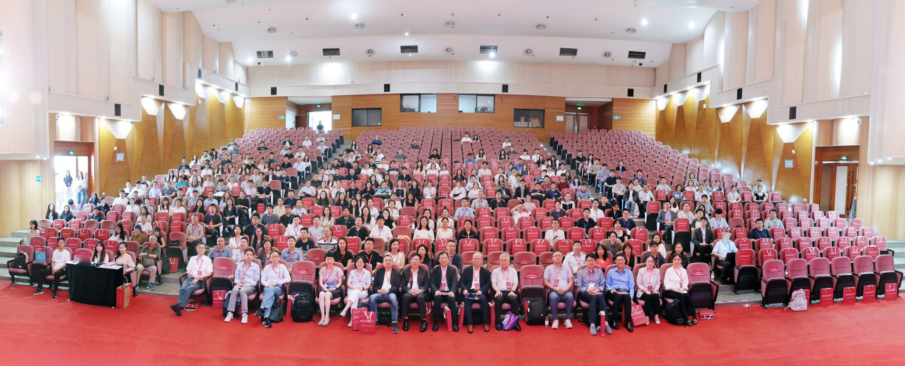

On the morning of July 4, the conference's opening ceremony was held at SWUFE. University leaders and school deans attended and delivered welcoming remarks, extending a warm welcome to the scholars who had come from China and abroad. Professor Kaiji Chen of Emory University, the current President of CES, spoke on behalf of the society, reviewing its mission of fostering economic exchange between China and the wider world and expressing heartfelt thanks to SWUFE for its meticulous preparations.

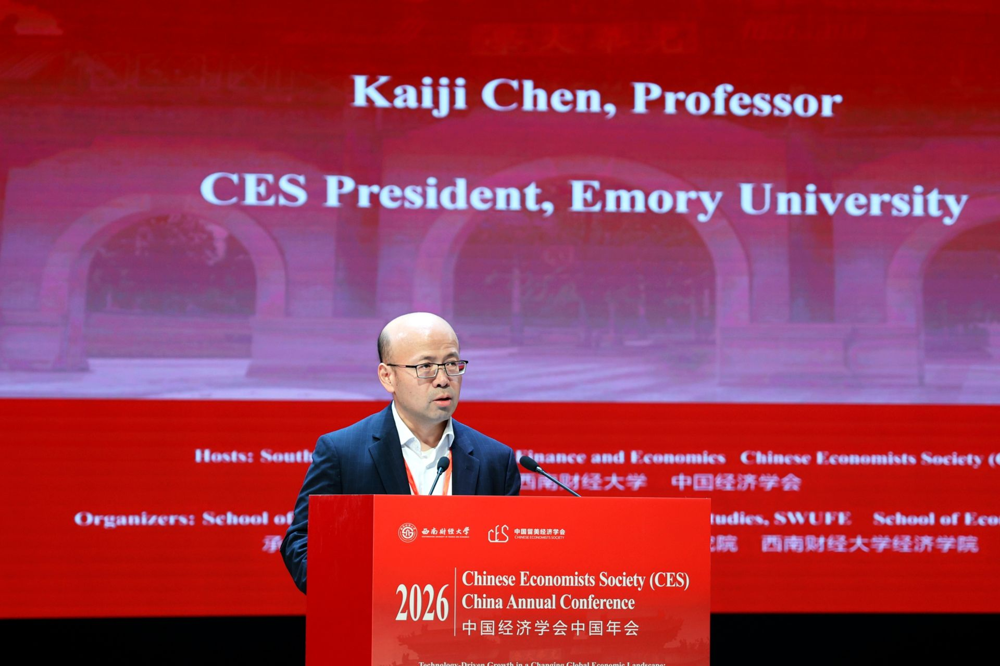

## Keynote Speeches

The conference invited five of the world's leading economists to deliver keynote speeches. In alphabetical order by surname, they were:

- **Professor Hanming Fang** — Norman C. Grosman Professor of Economics at the University of Pennsylvania; recipient of the 17th Kenneth Arrow Award of the International Health Economics Association (iHEA); Fellow of the Econometric Society; and Co-Editor of the *Journal of Health Economics*;
- **Professor Jianjun Miao** — Tsingshan Chair Professor and Dean of the School of Economics at Zhejiang University; formerly Professor of Economics at Boston University; Fellow of the Society for the Advancement of Economic Theory (SAET) and Senior Fellow of the Asian Bureau of Finance and Economic Research (ABFER); and founder of the China International Conference in Macroeconomics (CICM) and the China Macroeconomics Forum;
- **Professor Zheng (Michael) Song** — Wei Lun Professor of Economics and Chair of the Department of Economics at the Chinese University of Hong Kong; Fellow of the Econometric Society;
- **Professor Shang-Jin Wei** — N.T. Wang Professor of Chinese Business and Economy and Professor of Finance and Economics at Columbia University; Chief Economist of the Asian Development Bank from 2014 to 2016; and Director of the NBER's Working Group on the Chinese Economy;
- **Professor Wei Xiong** — John H. Scully '66 Professor of Finance and Professor of Economics at Princeton University; Academic Dean of the School of Management and Economics at the Chinese University of Hong Kong, Shenzhen; and Fellow of the Econometric Society.

On the morning of July 4, Professor Hanming Fang delivered the first keynote, titled "Addressing Population Ageing in China: Public Policy and Institutional Innovations." Drawing on his forthcoming book of the same name (Cambridge Elements, 2026), he systematically laid out the profound challenges that population ageing poses for the Chinese economy and, around such issues as old-age security, the financing of care, and work–family balance, explored how public policy and institutional innovation might respond — prompting lively discussion among the scholars in attendance.

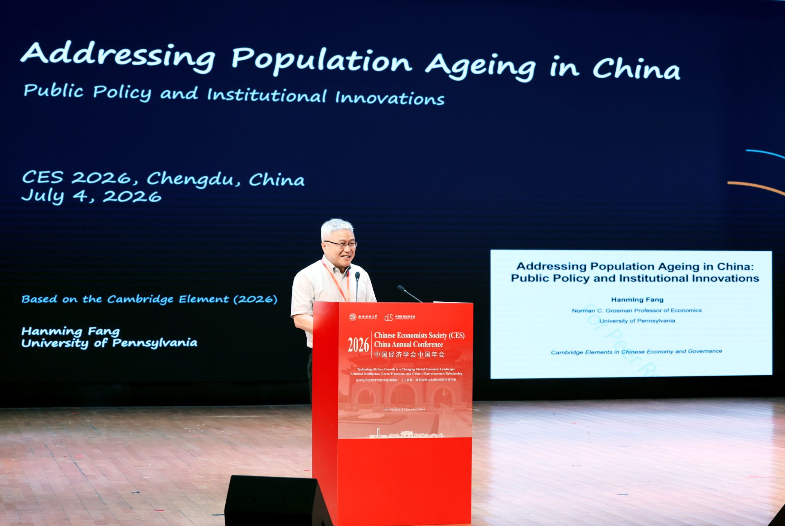

Professor Zheng (Michael) Song then delivered a keynote titled "A Lost Decade of Fiscal Misallocation" (moderated by CES President Kaiji Chen). The research is joint work with Kosuke Aoki (University of Tokyo), Ippei Fujiwara (Keio University), and Zhenhe Lin and Chendong Wang (Chinese University of Hong Kong). Starting from such structural features as high state capacity, large business conglomerates, and a bank-dominated financial system under strain — together with long-run trends including a steadily richer economy and rapidly ageing population — the talk offered an in-depth analysis of the long-term cost that the misallocation of fiscal resources imposes on economic growth, demonstrating a deep integration of frontier macroeconomic research with real-world questions about China.

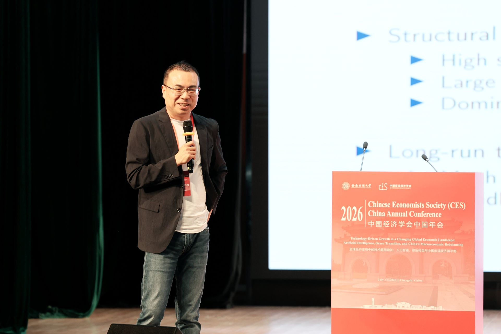

On the afternoon of July 4, Professor Jianjun Miao delivered a keynote titled "Transforming Luxuries into Necessities: How Inequality Affects Growth?" The research is joint work with Haofeng Du, Shenzhe Jiang, Yanzhe Wang, and Mingzhi Xu of Peking University. Invoking Schumpeter's famous dictum of 1942 — that the achievement of capitalism lies not in providing more silk stockings for queens but in bringing them within reach of the factory girls — the talk approached growth theory from the demand side: innovative products often begin as luxuries for the few and, as their prices fall, gradually become necessities for the many. Combining empirical evidence with an endogenous growth model, it systematically examined the mechanism by which income inequality shapes innovation and long-run growth through the size of market demand, and offered a quantitative assessment.

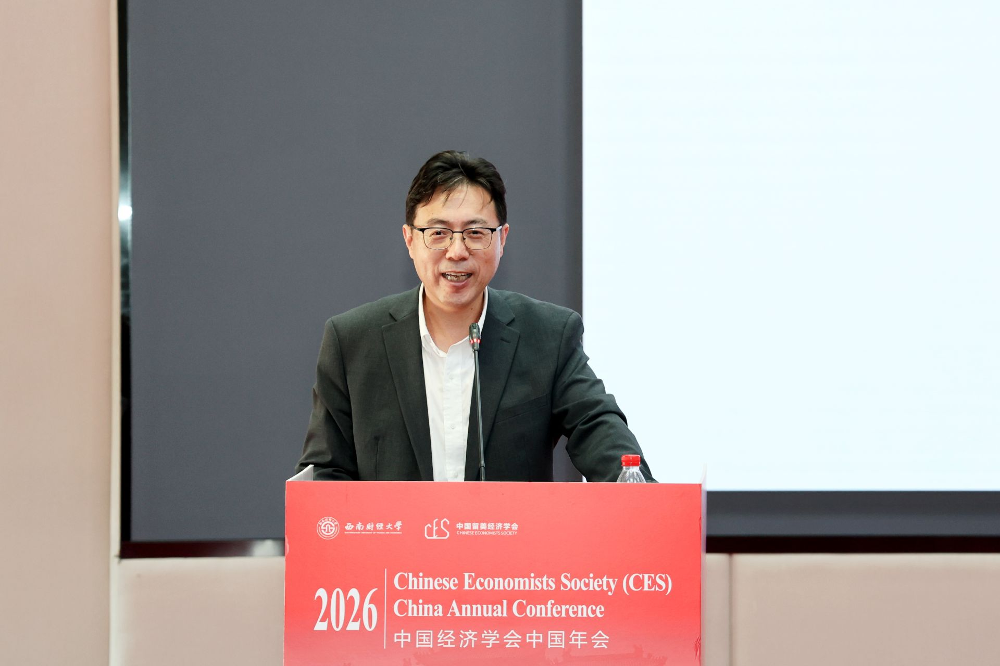

On the morning of July 5, Professor Shang-Jin Wei delivered a keynote titled "The Rise of the Digital Entrepreneurship in China: A Darwinian Perspective" (moderated by Professor Xiaobo Zhang). The research is joint work with Sai Ding (University of Glasgow), Wei Jiang (SWUFE), and Shengyu Li (University of New South Wales). Drawing on micro data such as economic census records, the talk presented stylized facts about China's wave of digital entrepreneurship and, through a Darwinian lens of "survival of the fittest," examined the entry, competition, and growth of the many new firms in the digital economy, exploring the forces driving the digital entrepreneurship boom and its significance for China's economic growth.

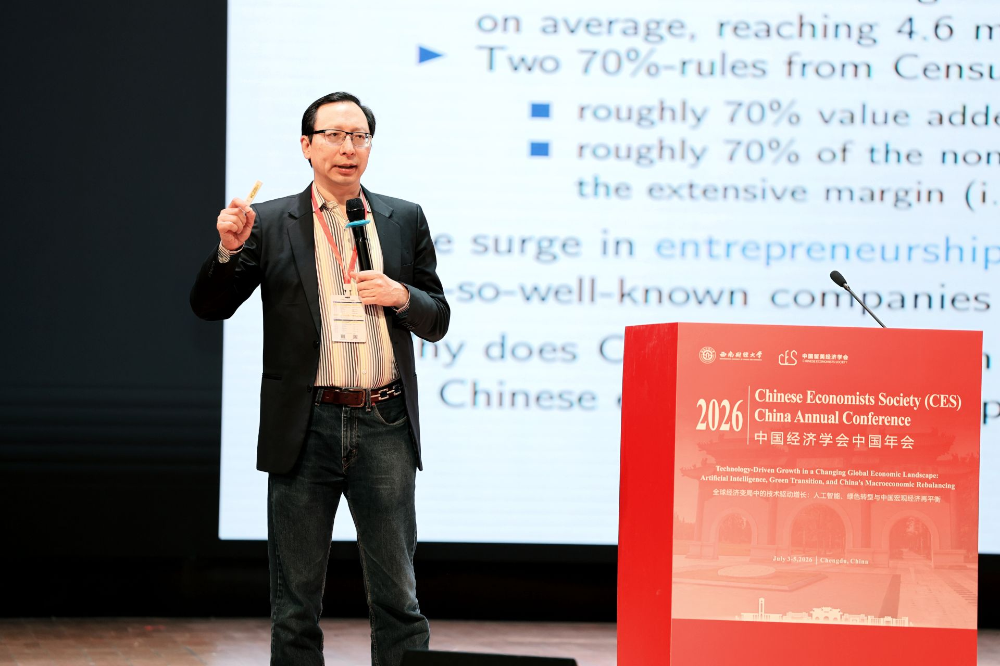

Professor Wei Xiong followed with a keynote titled "Mandarin Capitalism: China's Market-in-State Hierarchy" (moderated by Professor Pengfei Wang). Based on his new book, to be co-published in September 2027 by W.W. Norton and Penguin, the talk proposed an analytical framework for understanding China's economic system as a "market-in-state hierarchy," systematically setting out the logic of interaction between the government's bureaucratic hierarchy and the market mechanism, together with its far-reaching implications for resource allocation — offering a fresh perspective on China's political-economic system.

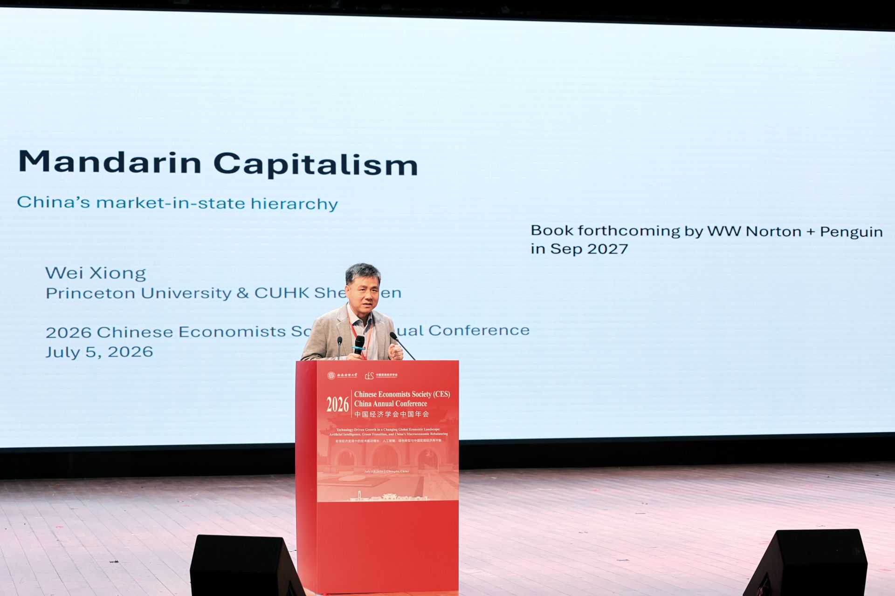

## Invited Speakers

The conference also invited 16 well-known scholars working at the frontiers of their respective fields to deliver invited talks. In alphabetical order by surname, they were: Hengjie Ai (University of Wisconsin–Madison), Xi Chen (Yale University), Yuanyuan Chen (Shanghai University of Finance and Economics), Zhao Chen (Fudan University), Chao Fu (University of Wisconsin–Madison), Shanjun Li (Stanford University), Jun Pan (Shanghai Advanced Institute of Finance, Shanghai Jiao Tong University), Pengfei Wang (HSBC Business School, Peking University), Xi Weng (Guanghua School of Management, Peking University), Dacheng Xiu (University of Chicago Booth School of Business), Daniel Yi Xu (Duke University), Vincent Yao (Georgia State University), Miaojie Yu (President of Liaoning University), Xiaobo Zhang (Guanghua School of Management, Peking University), Xiaoyan Zhang (PBC School of Finance, Tsinghua University), and Yaohui Zhao (Wuhan University). Many of the invited speakers also serve as editors or co-editors of leading international journals, and their latest research offered attendees a panoramic view of the frontier across the many fields of economics.

## Journal Editors' Panel Sessions

On the afternoon of July 4, three journal editors' panel sessions were held concurrently, focusing respectively on three broad areas: Macro/Finance, Applied Micro, and Development & Chinese Economy.

The Macro/Finance panel was moderated by Professor Jue Ren (Texas Christian University), with six scholars joining the discussion: Hengjie Ai (University of Wisconsin–Madison), Jianjun Miao (Zhejiang University), Jun Pan (SAIF, Shanghai Jiao Tong University), Pengfei Wang (Peking University), Wei Xiong (Princeton University), and Dacheng Xiu (University of Chicago).

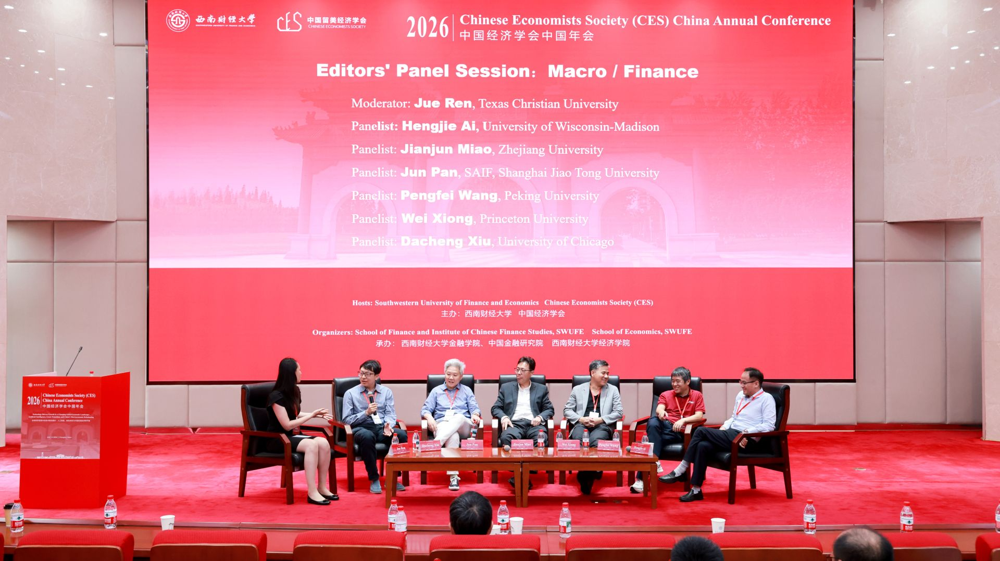

The Applied Micro panel was moderated by Professor Jing Tao (University of Washington), with five scholars joining the discussion: Xi Chen (Yale University), Zhao Chen (Fudan University), Chao Fu (University of Wisconsin–Madison), Shanjun Li (Stanford University), and Daniel Yi Xu (Duke University).

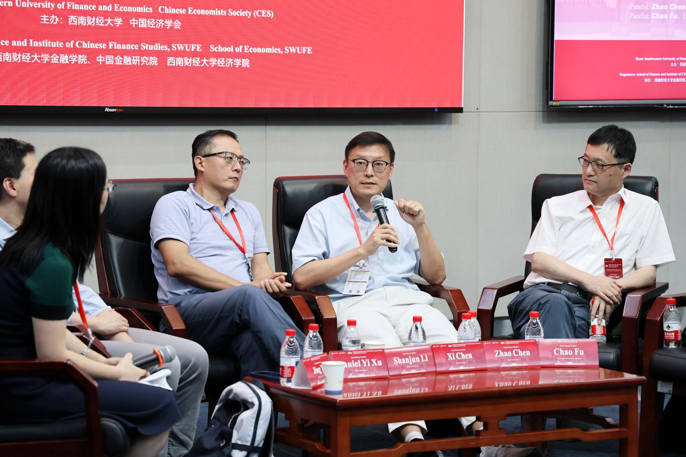

The Development & Chinese Economy panel was moderated by Professor Dan Lu (Chinese University of Hong Kong), with four scholars joining the discussion: Hanming Fang (University of Pennsylvania), Zheng (Michael) Song (Chinese University of Hong Kong), Xiaobo Zhang (Peking University), and Yaohui Zhao (Wuhan University). Across all three panels, the editors engaged in candid, in-depth exchanges with the audience on topics such as choosing research questions, writing and submission strategy, the peer-review process, and publishing China-focused economic research in international outlets — offering invaluable guidance to younger scholars.

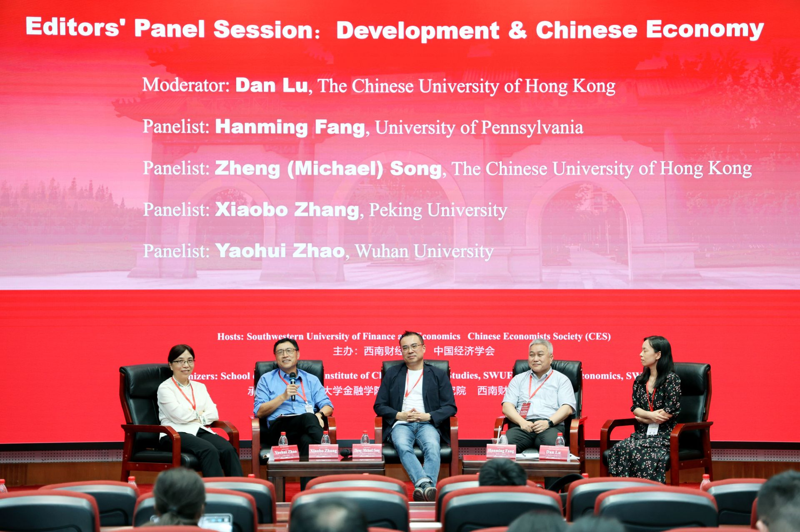

## Parallel Sessions

Over the two days of the conference, more than 500 papers were presented across the parallel sessions, spanning a wide range of topics including macroeconomics, finance, international trade, labor economics, health economics, development economics, artificial intelligence and the digital economy, and environmental and energy economics. The sessions were lively and filled to capacity, with participants engaging in thorough discussion and exchange around the papers.

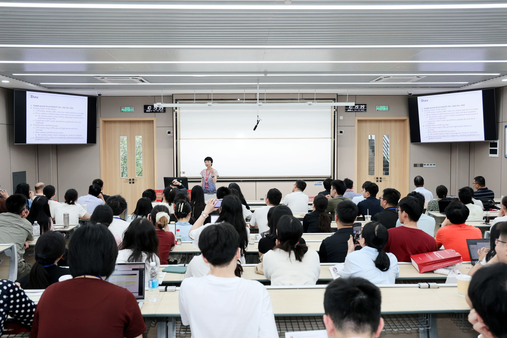

It is worth special mention that the conference's Program Committee was composed of 12 of the most research-productive mid-career economists active in Chinese economics today: Wei Cui (University College London), Feng Dong (Tsinghua University), Jingting Fan (Cheung Kong Graduate School of Business), Haoyu Gao (Renmin University of China), Jia He (Nankai University), Bo Li (Peking University), Bingjing Li (University of Hong Kong), Kai Li (Peking University), Dan Lu (Chinese University of Hong Kong), Hong Ma (Tsinghua University), Zhiwei Xu (Fudan University), and Yifan Zhang (Chinese University of Hong Kong). They personally took part in paper selection and best-paper adjudication, organized special sessions, and came to the conference to share their own latest research — greatly enhancing the academic caliber of this year's meeting.

## Best Paper Awards

The conference again presented the Gregory Chow Best Paper Award and the CES Best Student Paper Award, recognizing outstanding research by young scholars and current graduate students. The Gregory Chow Best Paper Award went to Anson Zhou of the University of Hong Kong, for the paper "The Fertility, Marriage, and Gender Equality Quandary." Two Best Student Paper Awards were also conferred at the closing ceremony. The establishment of these awards reflects CES's pursuit of academic excellence and its strong commitment to nurturing young talent.

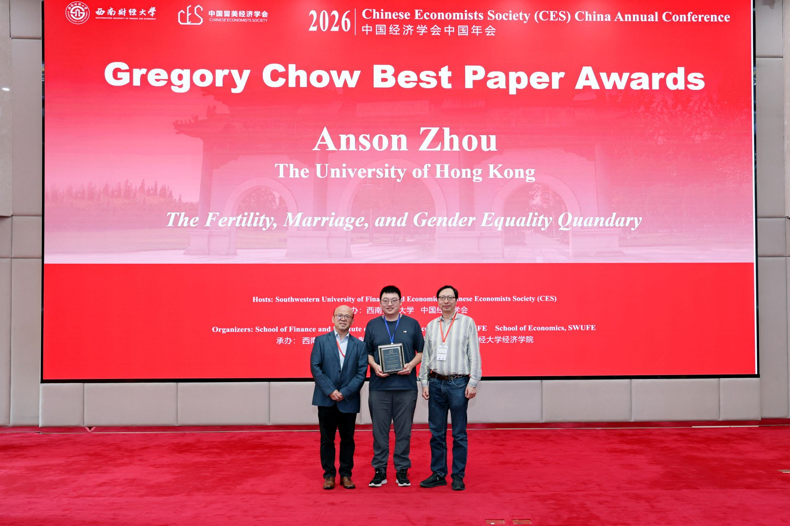

In addition, building on this year's conference, CES will organize two special issues — one in *China Economic Review* and one in *China Economic Journal* — giving priority to papers presented at the CES China and North America Annual Conferences and accepting submissions in Chinese, so as to encourage the publication of more high-quality research on important questions in the Chinese economy.

## A Successful Close: Onward to Shenyang in 2027

On the afternoon of July 5, the conference held its closing ceremony. Professor Suqin Ge of Virginia Tech, the President-elect of CES, together with Professor Miaojie Yu, President of Liaoning University, jointly announced that the 2027 CES China Annual Conference will be hosted by Liaoning University. A ceremonial handover of the conference flag brought the proceedings to their climax.

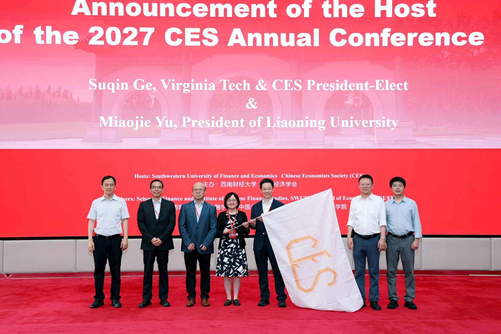

The 2026 CES China Annual Conference came to a successful close in the height of Chengdu's summer. The two days were vibrant and rewarding, with a rich scholarly atmosphere that fostered academic exchange and collaboration among Chinese economists at home and abroad, as well as scholars from many countries who study the Chinese economy — further affirming the bridging role that CES plays in connecting the economics community across China and the world.

The success of the conference would not have been possible without the active participation and generous support of every attendee. We extend our heartfelt thanks to all participating scholars, presenters, discussants, and session chairs for their enthusiastic engagement; our special thanks to the leadership team, faculty, students, and volunteers of SWUFE for their meticulous preparation over the past year and their warm hospitality during the meeting; and our gratitude to every member of the CES Board of Directors for their hard work and selfless dedication.

We look forward to gathering again with you all at Liaoning University in 2027, to advance high-level academic exchange and collaboration together!
