# 2026-CES 中国年会在西南财经大学成功召开

2026年7月3日至5日,中国留美经济学会(The Chinese Economists Society,简称CES)2026年中国年会在成都西南财经大学隆重举行。本次会议由中国留美经济学会与西南财经大学联合主办,西南财经大学金融学院、中国金融研究院和经济学院共同承办。年会以"全球经济变局中的技术驱动增长:人工智能、绿色转型与中国宏观经济再平衡"(Technology-Driven Growth in a Changing Global Economic Landscape: Artificial Intelligence, Green Transition, and China's Macroeconomic Rebalancing)为主题,来自海内外高校、研究机构和政策部门的众多经济学家齐聚蓉城,充分体现了CES作为联结海内外经济学家学术交流桥梁和纽带的重要作用。

本届年会规模盛大、议程充实:除7月3日的线上报告专场外,7月4日至5日两天时间里共有500多篇论文进行线下宣讲。会议设置了5场大会主旨演讲(Keynote Speech)、16位特邀学者的主题演讲专场,以及宏观/金融(Macro/Finance)、应用微观(Applied Micro)和发展与中国经济(Development & Chinese Economy)三场期刊主编圆桌论坛。尤为值得一提的是,今年CES中国年会首次与中国留澳大利亚经济学会和中国女性经济学家学会合作,设立了两个学会的专题场次(Special Sessions),进一步拓展了CES连接全球华人经济学者的学术网络。

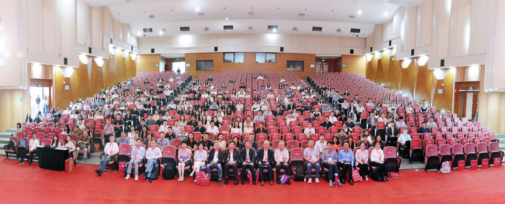

7月4日上午,年会开幕式在西南财经大学隆重举行。西南财经大学校领导和学院负责人出席开幕式并致欢迎辞,对来自海内外的与会学者表示热烈欢迎。CES现任会长、Emory大学陈凯迹(Kaiji Chen)教授代表学会致辞,回顾了CES促进海内外经济学交流的使命,并对西南财经大学的精心筹备表示衷心感谢。

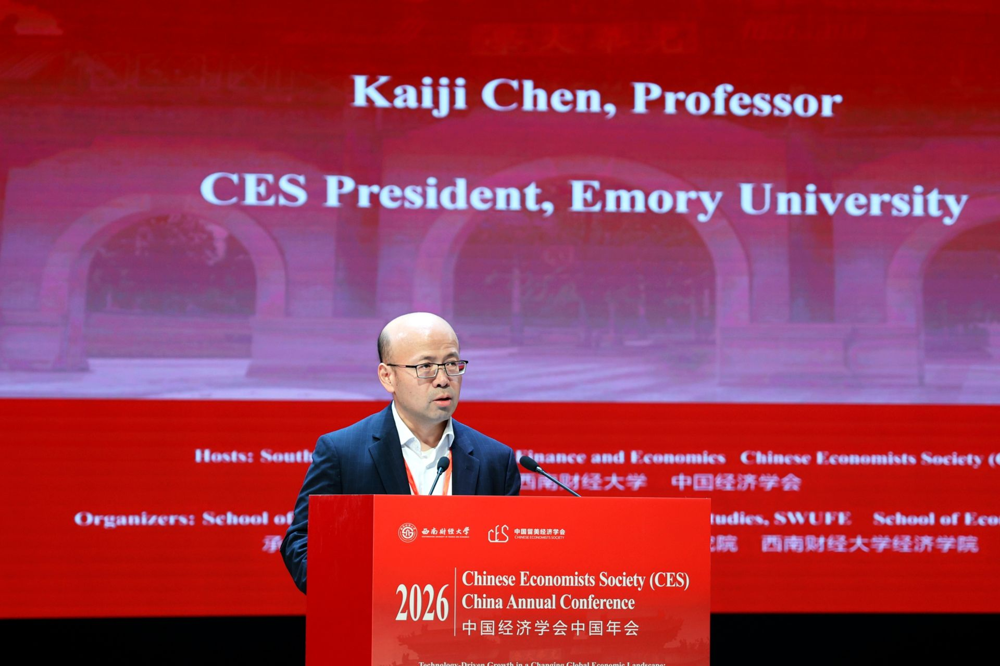

## 主旨演讲(Keynote Speeches)

本届年会邀请了五位国际顶尖经济学家发表主旨演讲,他们是(按姓氏字母排序):

- **方汉明(Hanming Fang)教授**,宾夕法尼亚大学Norman C. Grosman经济学讲席教授,国际健康经济学会(iHEA)第17届Kenneth Arrow奖得主,世界计量经济学会会士(Fellow of the Econometric Society),Journal of Health Economics联合主编;
- **苗建军(Jianjun Miao)教授**,浙江大学青山讲席教授(Tsingshan Chair Professor)、经济学院院长,曾任波士顿大学经济学教授,SAET会士、ABFER资深会士,中国宏观经济国际年会(CICM)和中国宏观经济论坛的创始人;
- **宋铮(Zheng Michael Song)教授**,香港中文大学伟伦经济学讲席教授、经济系系主任,世界计量经济学会会士;
- **魏尚进(Shang-Jin Wei)教授**,哥伦比亚大学N.T. Wang中国商业与经济讲席教授、金融与经济学教授,2014–2016年任亚洲开发银行首席经济学家,NBER中国经济研究组主任;
- **熊伟(Wei Xiong)教授**,普林斯顿大学John H. Scully '66金融学讲席教授、经济学教授,香港中文大学(深圳)经管学院学术院长,世界计量经济学会会士。

7月4日上午,方汉明教授率先发表题为"应对中国人口老龄化:公共政策与制度创新"(Addressing Population Ageing in China: Public Policy and Institutional Innovations)的主旨演讲。演讲基于他即将出版的同名专著(Cambridge Element, 2026),系统梳理了人口老龄化给中国经济带来的深刻挑战,并围绕养老保障、照护融资与工作—家庭平衡等议题,探讨了公共政策与制度创新的应对之道,引起与会学者的热烈讨论。

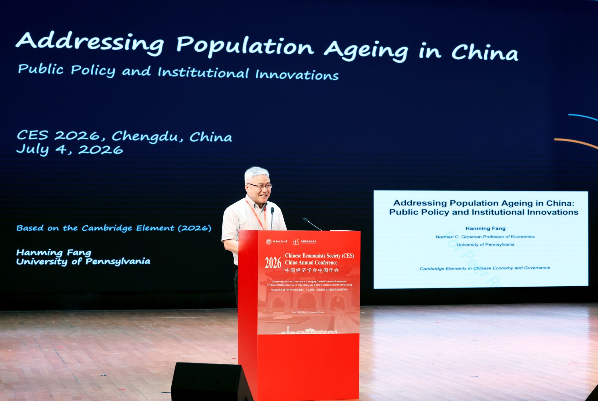

随后,宋铮教授以"财政错配的失落十年"(A Lost Decade of Fiscal Misallocation)为题发表主旨演讲(主持人:CES会长陈凯迹教授)。该研究与青木浩介(Kosuke Aoki,东京大学)、藤原一平(Ippei Fujiwara,庆应义塾大学)以及Zhenhe Lin、Chendong Wang(香港中文大学)合作完成。演讲从高国家能力、大型企业集团、银行主导且承压的金融体系等结构性特征,以及经济体日益富裕、人口快速老龄化等长期趋势切入,深入剖析了财政资源错配给经济增长带来的长期代价,展示了宏观经济研究前沿与中国现实问题的深度结合。

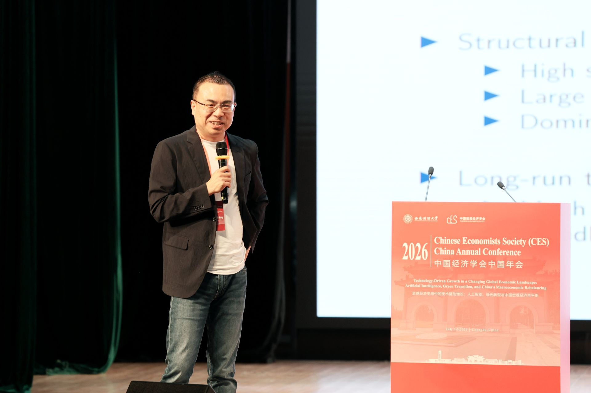

7月4日下午,苗建军教授发表题为"从奢侈品到必需品:不平等如何影响增长?"(Transforming Luxuries into Necessities: How Inequality Affects Growth?)的主旨演讲。该研究与北京大学的Haofeng Du、Shenzhe Jiang、Yanzhe Wang、Mingzhi Xu合作完成。演讲援引熊彼特(1942)的著名论断——资本主义成就的意义不在于为女王提供更多丝袜,而在于让工厂女工也买得起丝袜——从需求侧视角切入增长理论:创新产品最初往往是少数人的奢侈品,随着价格下降逐步转化为大众必需品。演讲结合实证证据与内生增长模型,系统考察了收入不平等通过市场需求规模影响创新与长期增长的机制,并给出了定量评估。

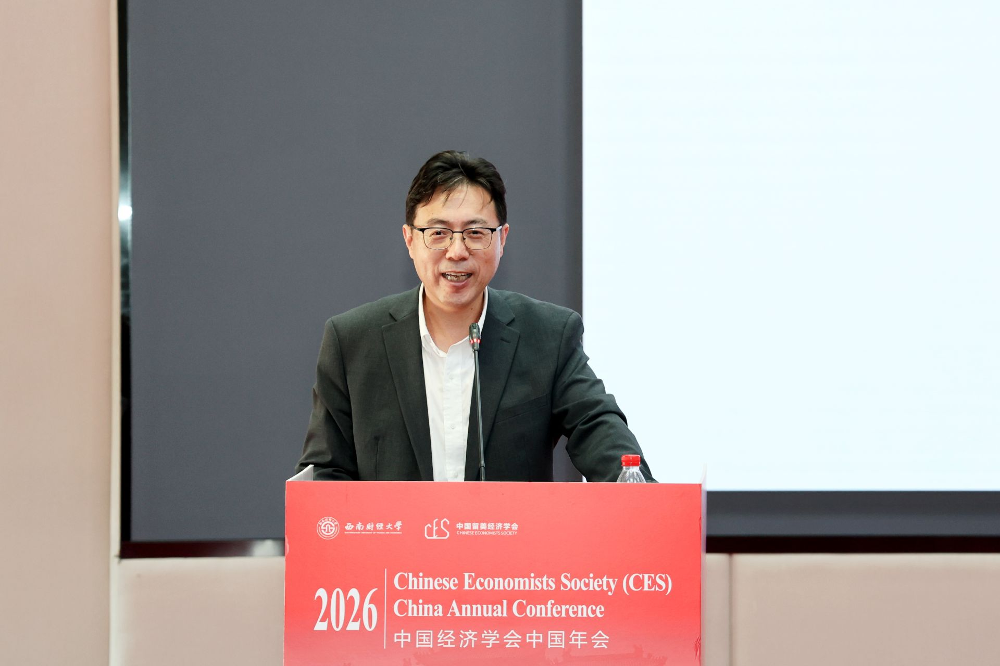

7月5日上午,魏尚进教授发表题为"中国数字创业的兴起:一个达尔文主义视角"(The Rise of the Digital Entrepreneurship in China: A Darwinian Perspective)的主旨演讲(主持人:张晓波教授)。该研究与Sai Ding(格拉斯哥大学)、Wei Jiang(西南财经大学)、Shengyu Li(新南威尔士大学)合作完成。演讲基于企业普查等微观数据展示了中国数字创业浪潮的典型事实,以"优胜劣汰"的达尔文主义视角审视数字经济中大量新企业的进入、竞争与成长,探讨了数字创业繁荣的动力及其对中国经济增长的意义。

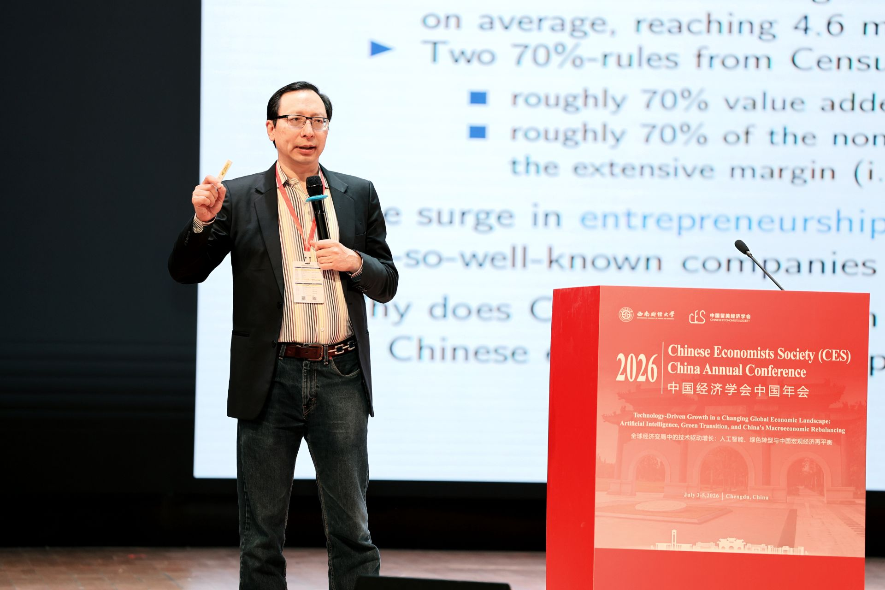

紧接着,熊伟教授发表题为"Mandarin Capitalism: China's Market-in-State Hierarchy"的主旨演讲(主持人:王鹏飞教授)。演讲基于他即将于2027年9月由W.W. Norton与Penguin出版社联合出版的新书,提出以"嵌入国家科层的市场"(market-in-state hierarchy)来理解中国经济体制的分析框架,系统阐述了政府科层组织与市场机制之间的互动逻辑及其对资源配置的深远影响,为理解中国政治经济体制提供了全新视角。

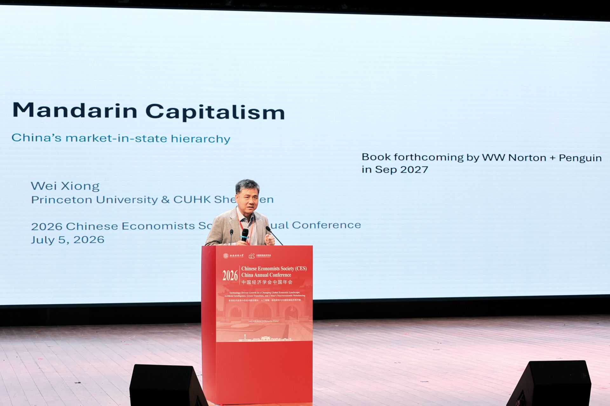

## 主题演讲(Invited Speakers)

本届年会还邀请了16位活跃在各领域前沿的知名学者发表主题演讲(按姓氏字母排序):Hengjie Ai(威斯康星大学麦迪逊分校)、陈希(Xi Chen,耶鲁大学)、陈钊(复旦大学)、陈媛媛(上海财经大学)、傅超(Chao Fu,威斯康星大学麦迪逊分校)、李善军(Shanjun Li,斯坦福大学)、潘军(Jun Pan,上海交通大学上海高级金融学院)、王鹏飞(Pengfei Wang,北京大学汇丰商学院)、翁翕(Xi Weng,北京大学光华管理学院)、修大成(Dacheng Xiu,芝加哥大学布斯商学院)、Daniel Yi Xu(杜克大学)、Vincent Yao(佐治亚州立大学)、余淼杰(Miaojie Yu,辽宁大学校长)、张晓波(Xiaobo Zhang,北京大学光华管理学院)、张晓燕(Xiaoyan Zhang,清华大学五道口金融学院)、赵耀辉(Yaohui Zhao,武汉大学)。多位主题演讲嘉宾同时担任国际知名期刊主编或联合主编,他们的最新研究成果为与会者呈现了经济学各领域的前沿图景。

## 期刊主编圆桌论坛

7月4日下午,三场期刊主编圆桌论坛(Editors' Panel Sessions)同步举行,分别聚焦宏观/金融、应用微观、发展与中国经济三大领域。

宏观/金融圆桌由Jue Ren教授(Texas Christian University)主持,Hengjie Ai(威斯康星大学麦迪逊分校)、苗建军(浙江大学)、潘军(上海交通大学高金)、王鹏飞(北京大学)、熊伟(普林斯顿大学)、修大成(芝加哥大学)六位学者参与讨论。

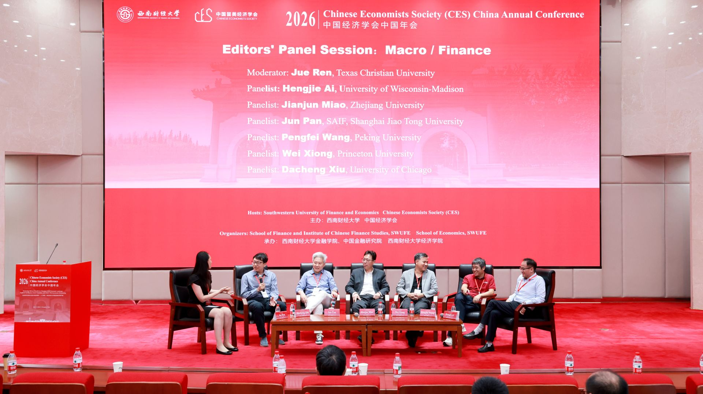

应用微观圆桌由Jing Tao教授(华盛顿大学)主持,Daniel Yi Xu(杜克大学)、李善军(斯坦福大学)、陈希(耶鲁大学)、陈钊(复旦大学)、傅超(威斯康星大学麦迪逊分校)等学者参与讨论。

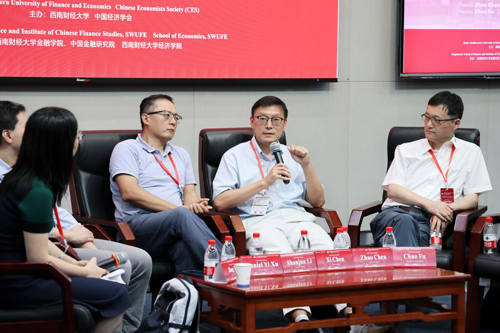

发展与中国经济圆桌由Dan Lu教授(香港中文大学)主持,方汉明(宾夕法尼亚大学)、宋铮(香港中文大学)、张晓波(北京大学)、赵耀辉(武汉大学)四位学者参与讨论。各场圆桌上,主编们就论文选题、写作与投稿策略、审稿流程以及中国经济研究的国际发表等话题与现场听众进行了坦诚而深入的交流,为青年学者提供了极具价值的指导。

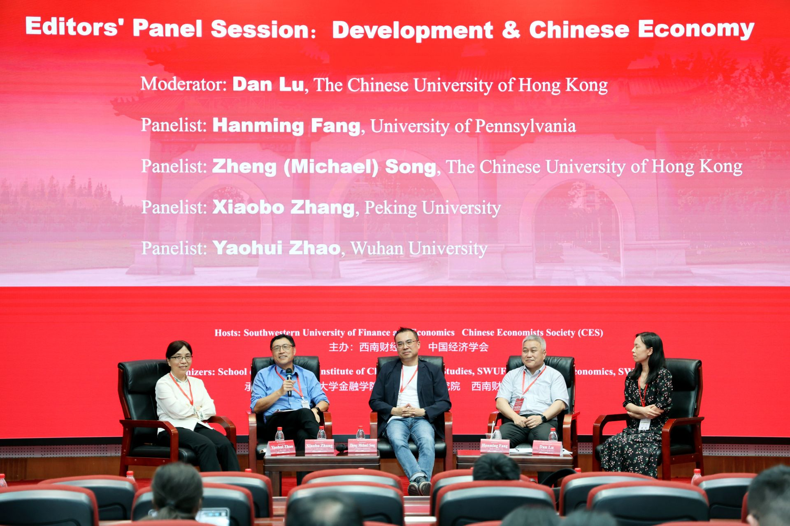

## 平行分会场

两天会期内,500多篇论文在各平行分会场进行了宣讲,议题覆盖宏观经济、金融、国际贸易、劳动经济学、健康经济学、发展经济学、人工智能与数字经济、环境与能源经济学等广泛领域。各分会场讨论热烈、座无虚席,与会学者围绕论文展开了充分的切磋与交流。

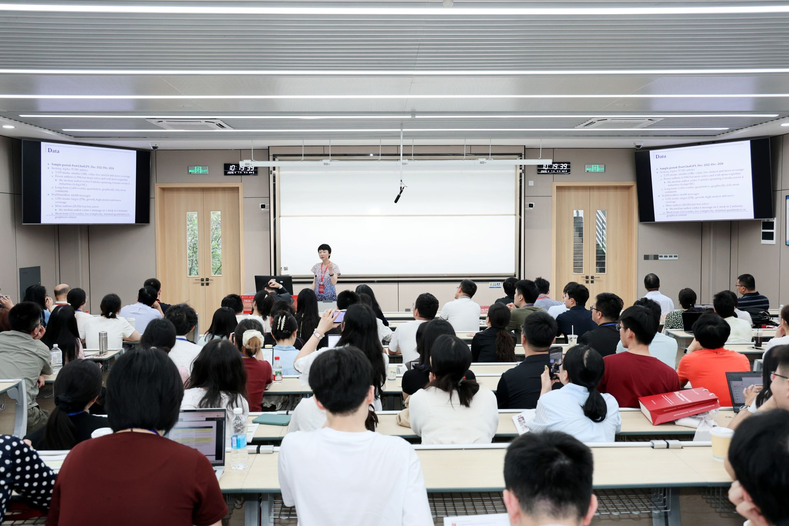

值得特别指出的是,本届年会的程序委员会(Program Committee)由目前活跃在中国经济学界的12位最具科研生产力的中生代(mid-career)经济学家组成:Wei Cui(伦敦大学学院)、Jingting Fan(长江商学院)、Dong Feng(清华大学)、Haoyu Gao(中国人民大学)、Jia He(南开大学)、Bo Li(北京大学)、Bingjing Li(香港大学)、Kai Li(北京大学)、Dan Lu(香港中文大学)、Hong Ma(清华大学)、Zhiwei Xu(复旦大学)、Yifan Zhang(香港中文大学)。他们亲自参与论文遴选和最佳论文评审,组织专题论坛,并来到年会分享各自的最新研究成果,极大地提升了本届年会的学术水准。

## 最佳论文奖

本届年会继续评选邹至庄最佳论文奖(Gregory Chow Best Paper Award)和CES最佳学生论文奖(CES Best Student Paper Award),以表彰青年学者和在读研究生的优秀研究成果。邹至庄最佳论文奖由香港大学Anson Zhou获得,获奖论文题为"The Fertility, Marriage, and Gender Equality Quandary"。两篇最佳学生论文奖也在闭幕式上一并颁出。奖项的设立与评选体现了CES对学术卓越的追求和对青年人才培养的高度重视。

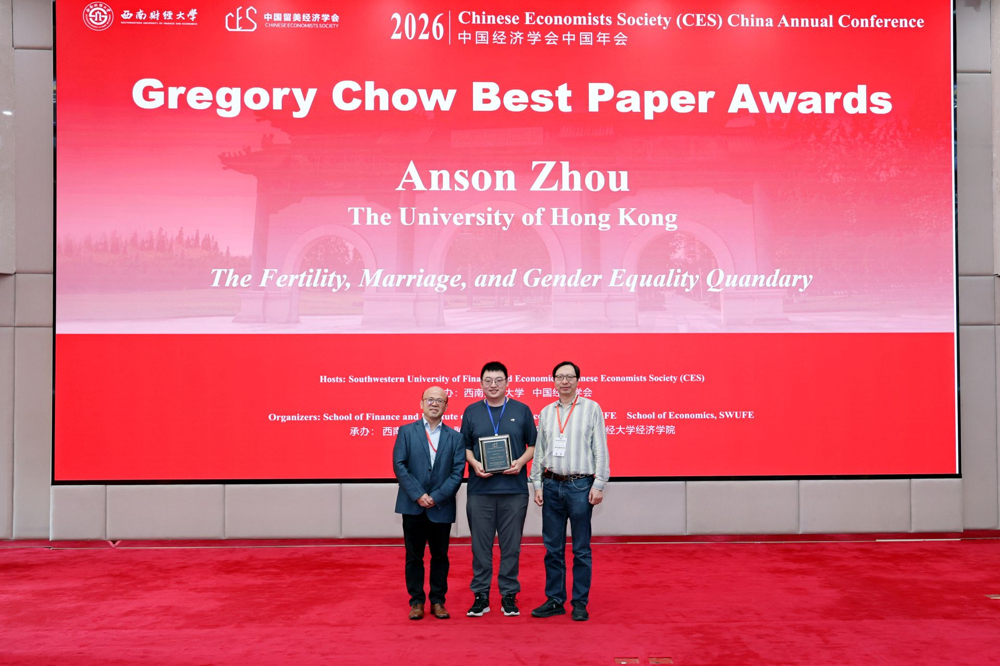

此外,CES将依托本届年会分别在China Economic Review和China Economic Journal组织两期特刊,优先考虑在CES中国年会和北美年会上宣讲的论文,并接受中文投稿,以鼓励更多聚焦中国经济重要问题的高质量研究成果发表。

## 圆满闭幕,相约沈阳

7月5日下午,年会举行闭幕式。CES候任会长、弗吉尼亚理工大学Suqin Ge教授与辽宁大学校长余淼杰教授共同宣布:2027年CES中国年会将由辽宁大学承办。会旗交接仪式将年会气氛推向高潮。

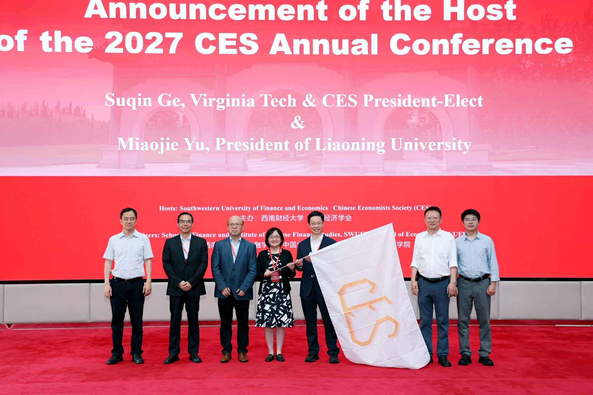

2026年CES中国年会在成都的盛夏中圆满落幕。两天的会议精彩纷呈、学术氛围浓厚,促进了海内外华人经济学者以及关注中国经济的各国学者之间的学术交流与合作,进一步彰显了CES联结海内外经济学界的桥梁作用。

年会的成功召开离不开每一位参会者的积极参与和大力支持。在此,我们衷心感谢所有参会学者、论文报告人、讨论人和会议主持人的热情投入;特别感谢西南财经大学领导团队和各位老师、同学、志愿者在过去一年中对本次年会的精心筹备以及会议期间的热情接待;感谢本届CES理事会每一位理事的辛勤付出和无私贡献。

我们期待2027年与大家在辽宁大学再次相聚,共同推动高水平学术交流与合作!
